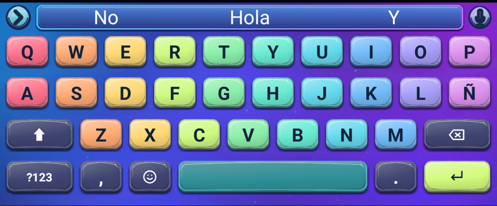
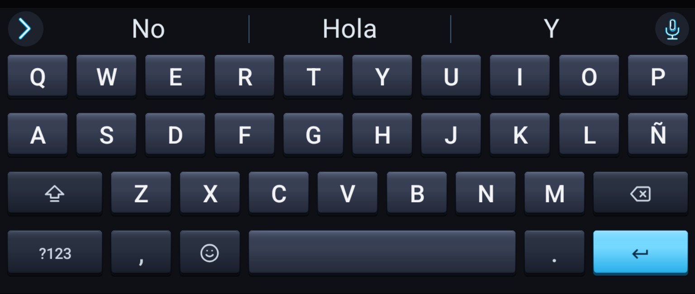

# FUTO Keyboard Themes

Colección de temas personalizados para **FUTO Keyboard**, diseñados y mantenidos por **Latan Villegas**.

[](https://github.com/latanvillegas/futo-keyboard-themes/actions/workflows/build-themes.yml)
[](https://github.com/latanvillegas/futo-keyboard-themes/releases/latest)

## Descargar

Los paquetes listos para instalar se publican en **GitHub Releases**:

**[Descargar la última versión](https://github.com/latanvillegas/futo-keyboard-themes/releases/latest)**

## Temas 3D destacados · v1.1.0

Dos diseños con teclas tridimensionales y personalización de la barra superior. Las imágenes siguientes son **capturas reales de referencia** de los temas, no renders promocionales.

### Aurora Prism Hyperglass 3D V9



Teclas de cristal **Hyperglass** en colores pastel, fondo Aurora azul-violeta y **barra de sugerencias continua**. Incluye acabados coordinados para el micrófono y el botón de expansión.

**[Descargar Aurora V9 (ZIP)](https://github.com/latanvillegas/futo-keyboard-themes/releases/download/v1.1.0/Aurora_3D_V9_Colores_Teclado.zip)** · [Ver versión v1.1.0](https://github.com/latanvillegas/futo-keyboard-themes/releases/tag/v1.1.0)

### Obsidian 3D Tactile V2



Teclas mecánicas **obsidiana oscura** con relieve 3D, sombras y acentos cian. Barra de sugerencias e iconos de micrófono y expansión adaptados a la misma estética.

**[Descargar Obsidian V2 (ZIP)](https://github.com/latanvillegas/futo-keyboard-themes/releases/download/v1.1.0/Obsidian3DTactile_FUTO_Original_Actualizado.zip)** · [Detalles y compatibilidad](dist/THEMES_AURORA_OBSIDIAN.md)

> **Compatibilidad:** para visualizar los fondos 9-slice de sugerencias y los controles 3D personalizados se necesita una compilación de [FUTO Keyboard Fork con motor V2.2](https://github.com/latanvillegas/android-keyboard/releases/tag/vfork-stable-56) o posterior. Los ZIP se importan desde **Configuración → Tema** y no deben descomprimirse. La apariencia puede variar según la pantalla y la configuración del teclado.

## Otros temas del catálogo · v1.0.0

### Temas disponibles

| Tema | Estilo | ZIP v1.0.0 |
| --- | --- | --- |
| AMOLED Purple Neon | Negro AMOLED + neón morado | [Descargar](https://github.com/latanvillegas/futo-keyboard-themes/releases/download/v1.0.0/amoled-purple-neon-FUTO.zip) |
| AMOLED Purple Clean | AMOLED morado minimalista | [Descargar](https://github.com/latanvillegas/futo-keyboard-themes/releases/download/v1.0.0/amoled-purple-clean-FUTO.zip) |
| AMOLED Purple Cyberpunk | Morado futurista / cyberpunk | [Descargar](https://github.com/latanvillegas/futo-keyboard-themes/releases/download/v1.0.0/amoled-purple-cyberpunk-FUTO.zip) |
| Midnight Aurora | Azul, violeta y turquesa | [Descargar](https://github.com/latanvillegas/futo-keyboard-themes/releases/download/v1.0.0/midnight-aurora-FUTO.zip) |
| Obsidian Gold | Obsidiana negra + detalles dorados | [Descargar](https://github.com/latanvillegas/futo-keyboard-themes/releases/download/v1.0.0/obsidian-gold-FUTO.zip) |
| Ancient Arcane | Arcano, violeta y oro envejecido | [Descargar](https://github.com/latanvillegas/futo-keyboard-themes/releases/download/v1.0.0/ancient-arcane-FUTO.zip) |

## Compilación automática

Los temas se generan mediante `tools/build_themes.py`. GitHub Actions ejecuta el generador, crea los ZIP instalables y los publica como artifacts. Al publicar una Release, los ZIP se adjuntan automáticamente a la versión.

```text
definición del tema
       ↓
tools/build_themes.py
       ↓
PNG / WebP / theme.txt
       ↓
ZIP instalable
       ↓
GitHub Actions / Releases
```

## Estructura

```text
.github/workflows/       Automatización de builds y Releases
tools/                   Generadores de temas
themes/                  Documentación y fuentes por tema
build/                   Salida temporal del generador
dist/                    ZIP instalables generados
```

## Autor

**Latan Villegas**

## Licencias y créditos

Los diseños y assets originales están sujetos a `LICENSE.md` y/o a la licencia incluida en cada tema. Las tipografías y otros componentes de terceros conservan sus autores, avisos y licencias originales. Cuando un tema incluya componentes de terceros, sus créditos deben mantenerse separados de la autoría del diseño.

## FUTO Keyboard

Proyecto independiente de temas personalizados para FUTO Keyboard. No implica afiliación, patrocinio ni respaldo oficial de FUTO.
